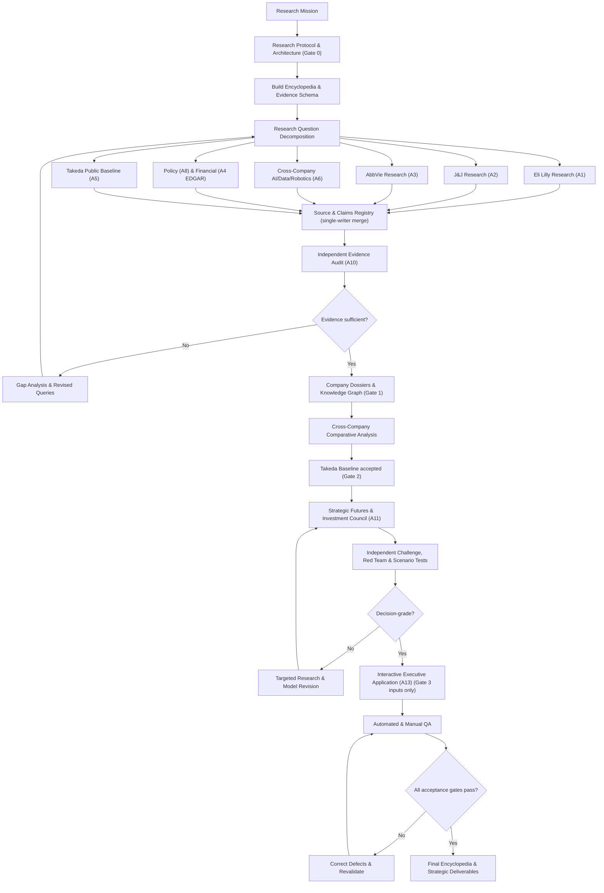

# Research dependency graph

Rendered interactively in the application (View: Methodology). Persisted here as Mermaid.

Node status is tracked in `PROJECT_STATE.md` and `.kiro/specs/medicine-2040/tasks.md`.
